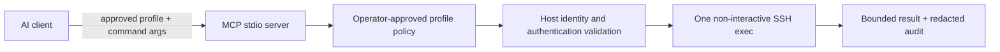

# ssh-mcp-server

Policy-driven SSH profile discovery, connection validation, and bounded remote
command execution for AI agents—without agent-supplied credentials.

Use this MCP server when an operator wants an agent to confirm that one of the
operator's already approved SSH profiles is ready for a subsequent,
operator-authorized step. The server exposes a deliberately small surface:
agents can discover safe profile identifiers, validate one approved connection,
and execute one non-interactive command through that profile. It never becomes
an SSH terminal.

> **Status:** `v1.0.0` is a source-built release. The native Windows runtime
> remains within its alpha support boundary. This repository is public,
> but npm publishing is disabled. No npm package, standalone binary, or license
> has been published. Distribution remains controlled from source; publishing
> or choosing a license is a separate decision.

## What it does—and does not do

| Supported                                                          | Explicitly not supported                                                                          |
| ------------------------------------------------------------------ | ------------------------------------------------------------------------------------------------- |
| List operator-approved profile IDs                                 | Interactive or persistent shell                                                                   |
| Validate approved host identity and authentication                 | File transfer or port forwarding                                                                  |
| Execute one bounded, non-interactive command with limited output   | Accept a host, user, port, path, SSH option, key, password, token, or command shell from an agent |
| Require request-bound, expiring human approval for `sudo`          | Alter remote privileges or contact a production VPS during tests                                  |
| Return stable, structured results and redacted local audit records | Reveal credentials, host keys, or command output in audit records                                 |

## Release package candidates

An authorized repository owner, member, or collaborator can comment exactly
`/generate-candidate` on an open, same-repository `release/<version>` or
`hotfix/<version>` pull request targeting `master`. The workflow validates the
immutable pull-request commit, then creates or verifies a GitHub prerelease
candidate and reports its result on the pull request.

The candidate version is derived from the stable branch version and the exact
pull-request commit. It is not an npm publication or a stable release. Because
the native Windows addon is ABI-specific, each candidate release has separate
Windows x64 assets for Node.js 22 and Node.js 24. Select the asset matching the
Node.js major version used by Codex, install it from a trusted local file, and
do not copy its addon into another environment. Before packaging, the workflow
requires the four exact successful checks from the canonical
`.github/workflows/ci.yml` workflow for that same commit (`validate` and
`validate-windows-native` on Node.js 22 and 24); missing, pending, failed, or
untrusted checks block the candidate. The prerelease is an internal delivery
artifact, not npm publication, a stable release, or public distribution.

Merged `release/*` and `hotfix/*` pull requests are backported automatically
from `master` to `develop`. Repository maintainers must configure the
repository-scoped `BACKPORT_TOKEN` Actions secret with the minimum permissions
described in the [automated backport guide](docs/backport-automation.md). The
workflow fails closed with an actionable error when the secret is unavailable;
this repository does not contain or claim to configure its value.

The package contains only the compiled runtime, production Windows trust and
approval-broker binaries, and the operator documentation, skill, and scripts
they require. It intentionally excludes source, tests, CI files, development
configuration, the POSIX native addon, and the test-only native addon.

Readiness is not authorization. A successful validation confirms only the
approved connection boundary. Remote execution remains bounded and
non-interactive; commands containing `sudo` require a separate server-issued,
one-time human approval token tied to the exact profile, command, arguments,
timeout, and output limit.

## How the boundary works



The agent sees only profile IDs from discovery, structured command output within
the requested limit, and stable failure codes. Connection metadata, credential
references, paths, known-hosts content, host-key material, and diagnostics stay
behind the trusted boundary. Failures are fail-closed.

## Platform support

| Platform                                            | Discovery                                         | `validate_connection`                                                                                                                      | Authentication readiness                                                                                                                                                                                                  |
| --------------------------------------------------- | ------------------------------------------------- | ------------------------------------------------------------------------------------------------------------------------------------------ | ------------------------------------------------------------------------------------------------------------------------------------------------------------------------------------------------------------------------- |
| Linux and macOS                                     | Available when the POSIX state root is configured | Available when the POSIX runtime is composed; unsafe or incomplete state fails closed at call time                                         | `agent-key` only, using a private known-hosts snapshot and a bounded OpenSSH ControlMaster check                                                                                                                          |
| Native Windows alpha                                | Available only on the supported native envelope   | Advertised only when the required native runtime and provider-composition boundaries are available; individual calls can still fail closed | Password profiles retain host verification and Credential Manager ordering; agent-key commands use the native verified OpenSSH/snapshot boundary. Remote execution additionally requires the native trusted audit journal |
| Other platforms or unsupported Windows environments | Not advertised                                    | Not advertised                                                                                                                             | Not supported                                                                                                                                                                                                             |

The Windows alpha supports only 64-bit Windows 11 23H2 or later, or Windows
Server 2022 or later, with 64-bit Node.js 22 or later and Microsoft OpenSSH
9.5.0.0 or later in the Windows system OpenSSH directory. See the
[Windows trust model](docs/windows-trust-model.md) for its authoritative
security boundary and [Windows installation and Codex setup](docs/windows-codex-setup.md)
for the complete, per-user procedure.

## Prerequisites and build

Install Node.js 22 or later, clone an approved source checkout, then run:

```sh
npm ci
npm run build
```

For the Windows alpha, the trusted checkout also needs the Windows C++ build
prerequisites for Node.js addons:

```powershell
npm run build:native
```

Do not use a copied build artifact as a substitute for a trusted local build.
The full Windows verification sequence is documented in the
[alpha delivery boundary](docs/windows-alpha-delivery.md).

## Configure approved profiles

Configuration is operator-owned local state. It contains connection metadata,
but never a password, private key, passphrase, token, or other secret.

### Linux and macOS

Set both absolute roots for the process that starts the MCP server:

```sh
export SSH_MCP_STATE_ROOT="/absolute/path/to/state"
export SSH_MCP_KNOWN_HOSTS_ROOT="/absolute/path/to/known-hosts"
export SSH_MCP_AUDIT_ROOT="/absolute/path/to/audit"
export SSH_MCP_AUDIT_KEY_FILE="/absolute/path/to/private/audit-key"
```

`SSH_MCP_STATE_ROOT` contains the fixed `connection-profiles.json` file.
`SSH_MCP_KNOWN_HOSTS_ROOT` contains one `<profile-id>.known_hosts` file for
each `known-hosts://<profile-id>` reference. Both roots and their files must be
owned by the MCP process user, must not be group- or world-writable, and must
not contain symbolic links. An unsafe or incomplete configuration fails
closed.

`SSH_MCP_AUDIT_ROOT` must be a separate operator-owned absolute directory with
no group/other write permission. `SSH_MCP_AUDIT_KEY_FILE` must be a separate
operator-owned `0600` file containing exactly `v1:` followed by 64 lowercase
hexadecimal characters. The server never generates this key; missing, invalid,
rotated, or chain-invalid audit state fails closed before an SSH connection.

This illustrative `connection-profiles.json` entry is suitable for the POSIX
`agent-key` flow; it does not name a real host or credential:

```json
{
  "profiles": [
    {
      "profileId": "staging-api",
      "host": "staging-api.example.invalid",
      "port": 22,
      "user": "example-user",
      "expectedHostFingerprint": "SHA256:REPLACE_WITH_APPROVED_FINGERPRINT",
      "authMode": "agent-key",
      "approvedKnownHostsReference": "known-hosts://staging-api"
    }
  ]
}
```

Obtain the corresponding host key and fingerprint from an independently
approved source. Do not trust an interactive first-connection prompt. POSIX
production validation deliberately has no password provider. For the complete,
reproducible procedure, see the [POSIX setup guide](docs/posix-setup.md).

### Native Windows alpha

Windows does **not** use the POSIX environment variables. It reads only the
current user's protected registry values:

```text
HKCU\Software\Vissoto\ssh-mcp-server\StateRoot
HKCU\Software\Vissoto\ssh-mcp-server\KnownHostsRoot
```

The detailed guide's provisioning helper creates one protected profile and
known-hosts leaf, validates the operator-supplied host key against its
fingerprint before writing, and explains the conditional `agent-key` and
`password` paths. Follow
[Windows installation and Codex setup](docs/windows-codex-setup.md) rather
than substituting environment variables, shared locations, `PATH`, WSL, or
administrator execution.

Before the first Windows remote command, initialize the protected audit key
with `npm run windows:audit:init`; rotate it only with
`npm run windows:audit:rotate`. See
[the Windows audit journal procedure](docs/windows-execution-audit-journal.md).

When `sudo` approval is needed, build and start the local native broker in a
separate operator console:

```powershell
npm run windows:approver
```

Copy the printed `SSH_MCP_APPROVER_PIPE` and
`SSH_MCP_APPROVER_SECRET` values into the trusted environment of the MCP
server. The broker is a single-request process: start it again for the next
approval. It never opens SSH or exposes an MCP tool; it only authenticates the
local peer and displays the exact approval prompt.

## Register with a Codex MCP client

Build first, then register the stdio server with absolute, operator-approved
paths. On Linux and macOS, register the two state roots with the server so the
configuration remains available when Codex starts it later. Remote execution
also requires the operator-owned audit root/key; configure the optional local
approver socket and secret when `sudo` approval is needed. The following is
illustrative; replace all paths with local trusted values:

```sh
codex mcp add ssh-mcp-server \
  --env SSH_MCP_STATE_ROOT=/absolute/path/to/state \
  --env SSH_MCP_KNOWN_HOSTS_ROOT=/absolute/path/to/known-hosts \
  --env SSH_MCP_AUDIT_ROOT=/absolute/path/to/audit \
  --env SSH_MCP_AUDIT_KEY_FILE=/absolute/path/to/audit.key \
  --env SSH_MCP_APPROVER_SOCKET=/absolute/path/to/ssh-mcp-approver.sock \
  --env SSH_MCP_APPROVER_SECRET_FILE=/absolute/path/to/ssh-mcp-approver.secret \
  -- /absolute/path/to/node /absolute/path/to/ssh-mcp-server/dist/server.js
codex mcp list
```

The MCP server reserves standard input and output for JSON-RPC. Do not run
`node dist/server.js` interactively as a diagnostic. On the native Windows
alpha, do **not** pass POSIX environment variables: follow the
[Windows installation and Codex setup](docs/windows-codex-setup.md), which uses
the protected per-user registry values and its required absolute `node.exe`
path.

## Tool reference

Only advertised tools may be called. A tool can be absent because its required
runtime boundary is unavailable; treat absence as a hard stop, not as a reason
to supply connection details yourself. The JSON below is the text payload in
the MCP tool result and all examples are illustrative.

### `list_approved_profiles`

Discover the safe profile IDs before attempting validation.

**Input schema**

```json
{
  "type": "object",
  "properties": {},
  "additionalProperties": false
}
```

Call it with `{}` (or no arguments). It rejects extra fields such as a state
root, host, or credential.

**Successful response**

```json
{
  "profiles": [
    {
      "profileId": "staging-api",
      "classification": "operator-approved"
    }
  ]
}
```

The response never exposes the host, username, credential reference,
known-hosts reference, path, or host key. If the tool is advertised but
discovery cannot safely access its provider, the error result is the fixed
text `Approved profile discovery is unavailable.`

### `execute_remote_command`

Execute one command on an approved profile. `command` is one executable token;
pass parameters in `args`. The local implementation never starts a shell, and
the SSH session is closed on success, failure, timeout, cancellation, or output
limit. The response contains `stdout` and `stderr` only up to `maxOutputBytes`.

```json
{
  "profileId": "staging-api",
  "command": "systemctl",
  "args": ["status", "api"],
  "timeoutMs": 30000,
  "maxOutputBytes": 65536
}
```

The bounded defaults are 30 seconds and 64 KiB; the maximums are 60 seconds
and 1 MiB. Commands that use `sudo`, `sudoedit`, `su`, `doas`, `runuser`, or
`pkexec` return `approval-required` until the host-injected
`HumanSudoApprovalProvider` issues an opaque one-use capability through
`request_sudo_approval`. The capability expires after one minute,
cannot be reused, and fails if the command or the immutable approved profile
identity changes. A boolean such as `approved: true` is not accepted as
authorization. A standalone CLI without a host approval callback returns
`approval-unavailable`. Production hosts may connect the typed
`ssh-mcp-approver` boundary: Unix socket on POSIX or SID-protected named pipe
on Windows. Destination, verified identity, and canonical command remain local
to that approver.

### `request_sudo_approval`

Requests human confirmation for one exact `sudo` command. The tool is state
changing and requires confirmation. It returns only `approved`, a stable
`code`, an opaque `operationId`, and an opaque one-use `capability` when the
configured trusted approval boundary confirms the request. It accepts no
caller token or boolean. The capability must be sent back only as
`approvalToken` on the exact matching
`execute_remote_command` request.

### `validate_connection`

Check readiness for exactly one operator-approved profile. Its one-field schema
does not permit connection settings or commands:

```json
{
  "type": "object",
  "properties": {
    "profileId": {
      "type": "string",
      "pattern": "^[a-z0-9]+(?:-[a-z0-9]+)*$"
    }
  },
  "required": ["profileId"],
  "additionalProperties": false
}
```

**Call and success response**

```json
{ "profileId": "staging-api" }
```

```json
{ "profileId": "staging-api", "ready": true }
```

**Failure response**

```json
{ "ready": false, "outcome": "failure", "code": "host-key-failure" }
```

The stable, non-sensitive failure codes are `invalid-input`,
`provider-failure`, `timeout`, `host-key-failure`,
`authentication-failure`, `connection-failure`, and `unknown`. `timeout`
uses `"outcome": "timeout"`; other failure codes use `"outcome": "failure"`.
An unavailable validation provider returns `provider-failure`. Do not infer
the remote host, change an SSH option, or retry with a made-up profile ID from
one of these results.

## Agent operating guidelines

When an operator asks to check a connection:

1. Call `list_approved_profiles` with `{}`.
2. Select only an ID from that response, unless the operator has explicitly
   authorized a specific already-approved ID.
3. Call `validate_connection` with only `{ "profileId": "…" }`.
4. Report the minimal result. Treat a missing tool, error result, or failure
   code as a hard stop.

Never invent a profile ID, request or paste keys/secrets, accept a dynamic
host or path, bypass the human `sudo` approval flow, open a persistent shell,
transfer files, forward ports, or retry a failed host/authentication check
with weaker settings.

## Security, diagnostics, and troubleshooting

The server is fail-closed and sends only JSON-RPC on standard output. Redacted
Every remote command execution attempt first writes a durable versioned
intent/finished event to the separate HMAC-chained audit journal, then emits
redacted audit events and
diagnostics to standard error. The local audit record contains the command,
allowlisted argument shapes, and an HMAC digest of the original argument
vector; raw positional values, flag values, headers, URL credentials, shell
assignments, stdout, and stderr are never written to audit. Sudo approval
requests are audited separately from command execution attempts. If the durable
journal is unavailable, the remote result is returned as
`execution-audit-unavailable`. A secondary audit sink failure returns
`provider-failure` only when the result is not already `outcome-unknown`. An
interrupted or missing finished event is exposed as `outcome-unknown` with a
null exit code and empty output; clients must not retry automatically. Timeout
or cancellation closes the server-controlled SSH channel/session but does not
promise to kill an already detached remote process. The first delivery targets
POSIX VPS hosts from POSIX or Windows clients; remote Windows-host quoting is
future work. Interactive persistent shells, scripts, free-form redirection or
pipes, file transfer, and port forwarding are excluded; file transfer belongs
to issue #94. Support
material must omit hosts, usernames, profile IDs, credential references, paths,
and secrets. For platform-specific troubleshooting, start with:

- [Windows SSH MCP Codex skill](skills/windows-ssh-mcp/SKILL.md)
- [Windows installation and Codex setup](docs/windows-codex-setup.md)
- [Windows password-profile troubleshooting](docs/windows/password-profile-troubleshooting.md)
- [Windows agent-key troubleshooting](docs/windows/agent-key-troubleshooting.md)
- [Windows trust model](docs/windows-trust-model.md)

## Development checks

Run the checks relevant to a source change:

```sh
npm run format:check
npm run lint
npm test
npm run build
```

The integration suite is opt-in and requires an explicitly configured test
environment: `SSH_INTEGRATION_TEST=true npm run test:integration`. It is not a
claim of deployment readiness and must not be pointed at a VPS without the
environment owner's authorization.
