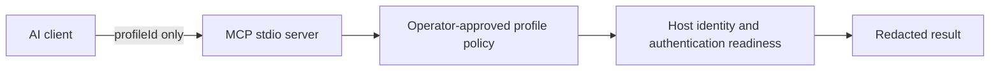

# ssh-mcp-server

Policy-driven SSH profile discovery and connection-readiness checks for AI
agents—without remote command execution or agent-supplied credentials.

Use this MCP server when an operator wants an agent to confirm that one of the
operator's already approved SSH profiles is ready for a subsequent,
operator-authorized step. The server exposes a deliberately small surface:
agents can discover safe profile identifiers and validate the readiness of one
such identifier. It never becomes an SSH terminal.

> **Status:** source-built alpha. This repository is public, but npm publishing
> is disabled. No npm package, standalone binary, or license has been
> published. Distribution remains controlled from source; publishing or choosing
> a license is a separate decision.

## What it does—and does not do

| Supported                                                  | Explicitly not supported                                                                     |
| ---------------------------------------------------------- | -------------------------------------------------------------------------------------------- |
| List operator-approved profile IDs                         | Execute remote commands or open an interactive shell                                         |
| Validate SSH connection readiness for one approved profile | Transfer files, deploy, forward ports, or change remote state                                |
| Verify approved host identity and authentication readiness | Accept a host, user, port, path, SSH option, key, password, token, or command from an agent  |
| Return a minimal, redacted readiness result                | Reveal hostnames, usernames, credential references, known-hosts paths, host keys, or secrets |

Readiness is not authorization. A successful result says only that the
approved connection's constrained readiness check completed; it does not
authorize a remote change, prove that a later operation is permitted, or widen
the MCP server's capabilities.

## How the boundary works



The agent sees only profile IDs from discovery and a small success or failure
payload. Connection metadata, credential references, paths, known-hosts
content, host-key material, and diagnostics stay behind the trusted boundary.
Failures are fail-closed.

## Platform support

| Platform                                            | Discovery                                         | `validate_connection`                                                                                    | Authentication readiness                                                                                                                                                                                   |
| --------------------------------------------------- | ------------------------------------------------- | -------------------------------------------------------------------------------------------------------- | ---------------------------------------------------------------------------------------------------------------------------------------------------------------------------------------------------------- |
| Linux and macOS                                     | Available when the POSIX state root is configured | Available when the POSIX runtime is composed; unsafe or incomplete state fails closed at call time       | `agent-key` only, using a private known-hosts snapshot and a bounded OpenSSH ControlMaster check                                                                                                           |
| Native Windows alpha                                | Available only on the supported native envelope   | Advertised only when every required native trust, storage, OpenSSH, and credential boundary is available | `agent-key` uses a bounded noninteractive TypeScript SSH runner with native trust preparation; `password` uses the in-memory transport and Windows Credential Manager when its prerequisites are available |
| Other platforms or unsupported Windows environments | Not advertised                                    | Not advertised                                                                                           | Not supported                                                                                                                                                                                              |

The Windows alpha supports only 64-bit Windows 11 23H2 or later, or Windows
Server 2022 or later, with 64-bit Node.js 22 or later and Microsoft OpenSSH
9.5.0.0 or later in the Windows system OpenSSH directory. See the
[Windows trust model](docs/windows-trust-model.md) for its authoritative
security boundary and [Windows installation and Codex setup](docs/windows-codex-setup.md)
for the complete, per-user procedure.

## Prerequisites and build

Install Node.js 22 or later, clone an approved source checkout, then run:

```sh
npm ci
npm run build
```

For the Windows alpha, the trusted checkout also needs the Windows C++ build
prerequisites for Node.js addons:

```powershell
npm run build:native
```

Do not use a copied build artifact as a substitute for a trusted local build.
The full Windows verification sequence is documented in the
[alpha delivery boundary](docs/windows-alpha-delivery.md).

## Configure approved profiles

Configuration is operator-owned local state. It contains connection metadata,
but never a password, private key, passphrase, token, or other secret.

### Linux and macOS

Set both absolute roots for the process that starts the MCP server:

```sh
export SSH_MCP_STATE_ROOT="/absolute/path/to/state"
export SSH_MCP_KNOWN_HOSTS_ROOT="/absolute/path/to/known-hosts"
```

`SSH_MCP_STATE_ROOT` contains the fixed `connection-profiles.json` file.
`SSH_MCP_KNOWN_HOSTS_ROOT` contains one `<profile-id>.known_hosts` file for
each `known-hosts://<profile-id>` reference. Both roots and their files must be
owned by the MCP process user, must not be group- or world-writable, and must
not contain symbolic links. An unsafe or incomplete configuration fails
closed.

This illustrative `connection-profiles.json` entry is suitable for the POSIX
`agent-key` flow; it does not name a real host or credential:

```json
{
  "profiles": [
    {
      "profileId": "staging-api",
      "host": "staging-api.example.invalid",
      "port": 22,
      "user": "example-user",
      "expectedHostFingerprint": "SHA256:REPLACE_WITH_APPROVED_FINGERPRINT",
      "authMode": "agent-key",
      "approvedKnownHostsReference": "known-hosts://staging-api"
    }
  ]
}
```

Obtain the corresponding host key and fingerprint from an independently
approved source. Do not trust an interactive first-connection prompt. POSIX
production validation deliberately has no password provider. For the complete,
reproducible procedure, see the [POSIX setup guide](docs/posix-setup.md).

### Native Windows alpha

Windows does **not** use the POSIX environment variables. It reads only the
current user's protected registry values:

```text
HKCU\Software\Vissoto\ssh-mcp-server\StateRoot
HKCU\Software\Vissoto\ssh-mcp-server\KnownHostsRoot
```

The detailed guide creates those per-user protected roots, configures
`connection-profiles.json`, protects the known-hosts leaves, and explains the
conditional `agent-key` and `password` paths. Follow
[Windows installation and Codex setup](docs/windows-codex-setup.md) rather
than substituting environment variables, shared locations, `PATH`, WSL, or
administrator execution.

## Register with a Codex MCP client

Build first, then register the stdio server with absolute, operator-approved
paths. On Linux and macOS, register the two state roots with the server so the
configuration remains available when Codex starts it later. The following is
illustrative; replace all paths with local trusted values:

```sh
codex mcp add ssh-mcp-server \
  --env SSH_MCP_STATE_ROOT=/absolute/path/to/state \
  --env SSH_MCP_KNOWN_HOSTS_ROOT=/absolute/path/to/known-hosts \
  -- /absolute/path/to/node /absolute/path/to/ssh-mcp-server/dist/server.js
codex mcp list
```

The MCP server reserves standard input and output for JSON-RPC. Do not run
`node dist/server.js` interactively as a diagnostic. On the native Windows
alpha, do **not** pass POSIX environment variables: follow the
[Windows installation and Codex setup](docs/windows-codex-setup.md), which uses
the protected per-user registry values and its required absolute `node.exe`
path.

## Tool reference

Only advertised tools may be called. A tool can be absent because its required
runtime boundary is unavailable; treat absence as a hard stop, not as a reason
to supply connection details yourself. The JSON below is the text payload in
the MCP tool result and all examples are illustrative.

### `list_approved_profiles`

Discover the safe profile IDs before attempting validation.

**Input schema**

```json
{
  "type": "object",
  "properties": {},
  "additionalProperties": false
}
```

Call it with `{}` (or no arguments). It rejects extra fields such as a state
root, host, or credential.

**Successful response**

```json
{
  "profiles": [
    {
      "profileId": "staging-api",
      "classification": "operator-approved"
    }
  ]
}
```

The response never exposes the host, username, credential reference,
known-hosts reference, path, or host key. If the tool is advertised but
discovery cannot safely access its provider, the error result is the fixed
text `Approved profile discovery is unavailable.`

### `validate_connection`

Check readiness for exactly one operator-approved profile. Its one-field schema
does not permit connection settings or commands:

```json
{
  "type": "object",
  "properties": {
    "profileId": {
      "type": "string",
      "pattern": "^[a-z0-9]+(?:-[a-z0-9]+)*$"
    }
  },
  "required": ["profileId"],
  "additionalProperties": false
}
```

**Call and success response**

```json
{ "profileId": "staging-api" }
```

```json
{ "profileId": "staging-api", "ready": true }
```

**Failure response**

```json
{ "ready": false, "outcome": "failure", "code": "host-key-failure" }
```

The stable, non-sensitive failure codes are `invalid-input`,
`provider-failure`, `timeout`, `host-key-failure`,
`authentication-failure`, `connection-failure`, and `unknown`. `timeout`
uses `"outcome": "timeout"`; other failure codes use `"outcome": "failure"`.
An unavailable validation provider returns `provider-failure`. Do not infer
the remote host, change an SSH option, or retry with a made-up profile ID from
one of these results.

## Agent operating guidelines

When an operator asks to check a connection:

1. Call `list_approved_profiles` with `{}`.
2. Select only an ID from that response, unless the operator has explicitly
   authorized a specific already-approved ID.
3. Call `validate_connection` with only `{ "profileId": "…" }`.
4. Report the minimal result. Treat a missing tool, error result, or failure
   code as a hard stop.

Never invent a profile ID, request or paste keys/secrets, accept a dynamic
host or path, turn readiness into permission for remote work, or attempt a
shell, command, file transfer, deployment, or a bypass of a failed check.

## Security, diagnostics, and troubleshooting

The server is fail-closed and sends only JSON-RPC on standard output. Redacted
audit events and diagnostics are written to standard error; support material
must omit hosts, usernames, profile IDs, credential references, paths, and
secrets. For platform-specific troubleshooting, start with:

- [Windows installation and Codex setup](docs/windows-codex-setup.md)
- [Windows agent-key troubleshooting](docs/windows/agent-key-troubleshooting.md)
- [Windows trust model](docs/windows-trust-model.md)

## Development checks

Run the checks relevant to a source change:

```sh
npm run format:check
npm run lint
npm test
npm run build
```

The integration suite is opt-in and requires an explicitly configured test
environment: `SSH_INTEGRATION_TEST=true npm run test:integration`. It is not a
claim of deployment readiness and must not be pointed at a VPS without the
environment owner's authorization.
