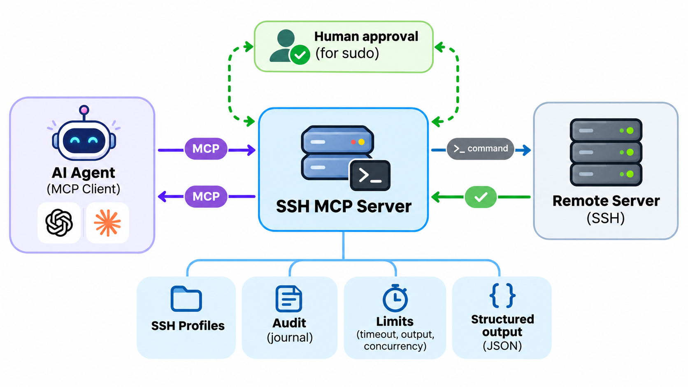
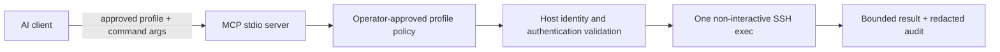

# SSH MCP Server



Policy-driven SSH profile discovery, connection validation, bounded remote
command execution, and exact SFTP upload for AI agents—without agent-supplied
credentials.

Use this MCP server when an operator wants an agent to confirm that one of the
operator's already approved SSH profiles is ready for a subsequent,
operator-authorized step. The server exposes a deliberately small surface:
agents can discover safe profile identifiers, validate one approved connection,
execute one non-interactive command, or upload one bounded file through that
profile. It never becomes an SSH terminal or a general file browser.

> **Status:** The native Windows runtime remains within its alpha support
> boundary. This repository is public, but npm publishing is disabled. No npm
> package, standalone binary, or license has been published. Distribution
> remains controlled from source; publishing or choosing a license is a
> separate decision.

## What it does—and does not do

| Supported                                                               | Explicitly not supported                                                                    |
| ----------------------------------------------------------------------- | ------------------------------------------------------------------------------------------- |
| List operator-approved profile IDs                                      | Interactive or persistent shell                                                             |
| Validate approved host identity and authentication                      | Download, directory listing, or port forwarding                                             |
| Execute one bounded, non-interactive command with limited output        | Accept a host, user, port, SSH option, key, password, token, or a local shell from an agent |
| Upload one exact SFTP file after explicit action approval               | Interactive or persistent SFTP session                                                      |
| Require request-bound, expiring human approval for privileged execution | Alter remote privileges or contact a production VPS during tests                            |
| Return stable, structured results and redacted local audit records      | Reveal credentials, host keys, or command output in audit records                           |

Readiness is not authorization. A successful validation confirms only the
approved connection boundary. Remote execution remains bounded and
non-interactive; it has no operational command allowlist. Recognized
privilege-escalation commands and command evaluators require a separate
server-issued, one-time human approval token tied to the exact profile,
command, arguments, timeout, and output limit.

## How the boundary works



The agent sees only profile IDs from discovery, structured command output within
the requested limit, and stable failure codes. Connection metadata, credential
references, paths, known-hosts content, host-key material, and diagnostics stay
behind the trusted boundary. Failures are fail-closed.

## Platform support

| Platform                                            | Discovery                                         | `validate_connection`                                                                                                                    | `upload_remote_file`                                                                                                                                            |
| --------------------------------------------------- | ------------------------------------------------- | ---------------------------------------------------------------------------------------------------------------------------------------- | --------------------------------------------------------------------------------------------------------------------------------------------------------------- |
| Linux and macOS                                     | Available when the POSIX state root is configured | `agent-key` only, using a private known-hosts snapshot and a bounded OpenSSH ControlMaster check                                         | `agent-key` only, when the POSIX state, known-hosts roots, audit root, and audit key are configured safely                                                      |
| Native Windows alpha                                | Available only on the supported native envelope   | Password profiles retain host verification and Credential Manager ordering; agent-key uses the native verified OpenSSH/snapshot boundary | Password profiles only, when the trusted native audit journal is available; `agent-key` upload remains unavailable until a native verified SFTP boundary exists |
| Other platforms or unsupported Windows environments | Not advertised                                    | Not advertised                                                                                                                           | Not advertised                                                                                                                                                  |

The Windows alpha supports only 64-bit Windows 11 23H2 or later, or Windows
Server 2022 or later, with 64-bit Node.js 22 or later and Microsoft OpenSSH
9.5.0.0 or later in the Windows system OpenSSH directory. See the
[Windows trust model](docs/windows-trust-model.md) for its authoritative
security boundary and [Windows installation and Codex setup](docs/windows-codex-setup.md)
for the complete, per-user procedure.

## Prerequisites and build

Install Node.js 22 or later, clone an approved source checkout, then run:

```sh
npm ci
npm run build
```

For the Windows alpha, the trusted checkout also needs the Windows C++ build
prerequisites for Node.js addons:

```powershell
npm run build:native
```

Do not use a copied build artifact as a substitute for a trusted local build.
The full Windows verification sequence is documented in the
[alpha delivery boundary](docs/windows-alpha-delivery.md).

## Configure approved profiles

Configuration is operator-owned local state. It contains connection metadata,
but never a password, private key, passphrase, token, or other secret.

### Linux and macOS

Set both absolute roots for the process that starts the MCP server:

```sh
export SSH_MCP_STATE_ROOT="/absolute/path/to/state"
export SSH_MCP_KNOWN_HOSTS_ROOT="/absolute/path/to/known-hosts"
export SSH_MCP_AUDIT_ROOT="/absolute/path/to/audit"
export SSH_MCP_AUDIT_KEY_FILE="/absolute/path/to/private/audit-key"
```

`SSH_MCP_STATE_ROOT` contains the fixed `connection-profiles.json` file.
`SSH_MCP_KNOWN_HOSTS_ROOT` contains one `<profile-id>.known_hosts` file for
each `known-hosts://<profile-id>` reference. Both roots and their files must be
owned by the MCP process user, must not be group- or world-writable, and must
not contain symbolic links. An unsafe or incomplete configuration fails
closed.

`SSH_MCP_AUDIT_ROOT` must be a separate operator-owned absolute directory with
no group/other write permission. `SSH_MCP_AUDIT_KEY_FILE` must be a separate
operator-owned `0600` file containing exactly `v1:` followed by 64 lowercase
hexadecimal characters. The server never generates this key; missing, invalid,
rotated, or chain-invalid audit state fails closed before an SSH connection.

This illustrative `connection-profiles.json` entry is suitable for the POSIX
`agent-key` flow; it does not name a real host or credential:

```json
{
  "profiles": [
    {
      "profileId": "staging-api",
      "host": "staging-api.example.invalid",
      "port": 22,
      "user": "example-user",
      "expectedHostFingerprint": "SHA256:REPLACE_WITH_APPROVED_FINGERPRINT",
      "authMode": "agent-key",
      "approvedKnownHostsReference": "known-hosts://staging-api"
    }
  ]
}
```

Obtain the corresponding host key and fingerprint from an independently
approved source. Do not trust an interactive first-connection prompt. POSIX
production validation deliberately has no password provider. For the complete,
reproducible procedure, see the [POSIX setup guide](docs/posix-setup.md).

### Native Windows alpha

Windows does **not** use the POSIX environment variables. It reads only the
current user's protected registry values:

```text
HKCU\Software\Vissoto\ssh-mcp-server\StateRoot
HKCU\Software\Vissoto\ssh-mcp-server\KnownHostsRoot
```

The detailed guide's provisioning helper creates one protected profile and
known-hosts leaf, validates the operator-supplied host key against its
fingerprint before writing, and explains the conditional `agent-key` and
`password` paths. Follow
[Windows installation and Codex setup](docs/windows-codex-setup.md) rather
than substituting environment variables, shared locations, `PATH`, WSL, or
administrator execution.

Before the first Windows remote command, initialize the protected audit key
with `npm run windows:audit:init`; rotate it only with
`npm run windows:audit:rotate`. See
[the Windows audit journal procedure](docs/windows-execution-audit-journal.md).

When `sudo` approval is needed, build and start the local native broker in a
separate operator console:

```powershell
npm run windows:approver
```

Copy the printed `SSH_MCP_APPROVER_PIPE` and
`SSH_MCP_APPROVER_SECRET` values into the trusted environment of the MCP
server. The broker is a single-request process: start it again for the next
approval. It never opens SSH or exposes an MCP tool; it only authenticates the
local peer and displays the exact approval prompt.

## Register with a Codex MCP client

Build first, then register the stdio server with absolute, operator-approved
paths. On Linux and macOS, register the two state roots with the server so the
configuration remains available when Codex starts it later. Remote execution
also requires the operator-owned audit root/key; configure the optional local
approver socket and secret when `sudo` approval is needed. The following is
illustrative; replace all paths with local trusted values:

```sh
codex mcp add ssh-mcp-server \
  --env SSH_MCP_STATE_ROOT=/absolute/path/to/state \
  --env SSH_MCP_KNOWN_HOSTS_ROOT=/absolute/path/to/known-hosts \
  --env SSH_MCP_AUDIT_ROOT=/absolute/path/to/audit \
  --env SSH_MCP_AUDIT_KEY_FILE=/absolute/path/to/audit.key \
  --env SSH_MCP_APPROVER_SOCKET=/absolute/path/to/ssh-mcp-approver.sock \
  --env SSH_MCP_APPROVER_SECRET_FILE=/absolute/path/to/ssh-mcp-approver.secret \
  -- /absolute/path/to/node /absolute/path/to/ssh-mcp-server/dist/server.js
codex mcp list
```

The MCP server reserves standard input and output for JSON-RPC. Do not run
`node dist/server.js` interactively as a diagnostic. On the native Windows
alpha, do **not** pass POSIX environment variables: follow the
[Windows installation and Codex setup](docs/windows-codex-setup.md), which uses
the protected per-user registry values and its required absolute `node.exe`
path.

## Tool reference

Only advertised tools may be called. A tool can be absent because its required
runtime boundary is unavailable; treat absence as a hard stop, not as a reason
to supply connection details yourself. The JSON below is the text payload in
the MCP tool result and all examples are illustrative. Each tool advertises an
`outputSchema`. JSON results are returned in both the existing text `content`
and, where applicable, MCP `structuredContent`; legacy plain-text availability
errors retain their existing text-only form. These schemas describe public,
redacted fields only.

### `list_approved_profiles`

Discover the safe profile IDs before attempting validation.

**Input schema**

```json
{
  "type": "object",
  "properties": {},
  "additionalProperties": false
}
```

Call it with `{}` (or no arguments). It rejects extra fields such as a state
root, host, or credential.

**Successful response**

```json
{
  "profiles": [
    {
      "profileId": "staging-api",
      "classification": "operator-approved"
    }
  ]
}
```

The response never exposes the host, username, credential reference,
known-hosts reference, path, or host key. If the tool is advertised but
discovery cannot safely access its provider, the error result is the fixed
text `Approved profile discovery is unavailable.` and remains text-only.

The structured response schema requires `profiles`; each entry contains only a
safe `profileId` and the `operator-approved` classification.

### `get_windows_readiness_status`

Inspect local Windows runtime prerequisites when this tool is advertised. It
never contacts a remote host and accepts `{}` only. Its structured response
contains the fixed `kind` and `version` plus the bounded fields `runtime`,
`registry`, `filesystem`, `configuration`, `knownHosts`, `credentials`,
`validationProvider`, and `remoteAuthentication`. `remoteAuthentication` is
always `not-checked`; readiness is not remote authorization. If the provider
is unavailable, the legacy text error is `Windows readiness status is
unavailable.`

**Call**

```json
{}
```

**Structured success response**

```json
{
  "kind": "windows-readiness-status",
  "version": 1,
  "runtime": "ready",
  "registry": "ready",
  "filesystem": "ready",
  "configuration": "ready",
  "knownHosts": "ready",
  "credentials": "not-checked",
  "validationProvider": "ready",
  "remoteAuthentication": "not-checked"
}
```

**Legacy failure response**

```json
{
  "content": [{ "type": "text", "text": "Windows readiness status is unavailable." }],
  "isError": true
}
```

The success JSON is present in both `content[0].text` and
`structuredContent`. The availability failure remains text-only for clients
that depend on the legacy response.

### `execute_remote_command`

Execute one command on an approved profile. `command` is one executable token;
pass parameters in `args`. The local implementation never starts a shell, and
the SSH session is closed on success, failure, timeout, cancellation, or output
limit. The response contains `stdout` and `stderr` only up to `maxOutputBytes`.
The tool is conservatively annotated as potentially destructive and open-world;
those annotations are advisory metadata and do not enforce confirmation.

```json
{
  "profileId": "staging-api",
  "command": "systemctl",
  "args": ["status", "api"],
  "timeoutMs": 30000,
  "maxOutputBytes": 65536
}
```

The bounded defaults are 30 seconds and 64 KiB; the maximums are 60 seconds
and 1 MiB. There is no allowlist for remote executables or argument shapes.
Commands that use `sudo`, `sudoedit`, `su`, `doas`, `dzdo`, `runuser`, or
`pkexec`, and command evaluators such as `sh`, `bash`, PowerShell, Python,
`env`, `xargs`, or `ssh`, return `approval-required` until the MCP client
obtains explicit user confirmation through `request_action_approval` with
`action: "remote-command"`. The capability expires after one minute, cannot
be reused, and fails if the command or the immutable approved profile identity
changes. A boolean such as `approved: true` is not accepted as authorization.
A successful or failed call returns structured fields
`operationId`, `profileId`, `outcome`, `code`, `exitCode`, `stdout`, `stderr`,
and `outputTruncated` in addition to the existing text JSON. The stable codes
include `success`, `remote-failure`, `connection-failure`,
`authentication-failure`, `host-key-failure`, `timeout`, `cancelled`,
`approval-required`, `approval-expired`, `approval-altered`,
`approval-reused`, `approval-unavailable`, `approval-busy`,
`approval-rejected`, `execution-limit`, `execution-audit-unavailable`,
`outcome-unknown`, `invalid-input`, `invalid-request`, `invalid-command`,
`invalid-arguments`, `invalid-timeout`, `invalid-output-limit`, and
`provider-failure`. For an invalid command request, the result retains a
syntactically valid requested `profileId`; otherwise it reports `unknown`.
The server does not access a profile or transport for invalid requests.

**Structured success response**

```json
{
  "operationId": "0123456789abcdef0123456789abcdef",
  "profileId": "staging-api",
  "outcome": "success",
  "code": "success",
  "exitCode": 0,
  "stdout": "status: active\n",
  "stderr": "",
  "outputTruncated": false
}
```

**Structured failure response**

```json
{
  "operationId": "0123456789abcdef0123456789abcdef",
  "profileId": "staging-api",
  "outcome": "unknown",
  "code": "outcome-unknown",
  "exitCode": null,
  "stdout": "",
  "stderr": "",
  "outputTruncated": false
}
```

Execution failures set `isError: true` when the result is not a successful
execution or an `approval-required` handoff. The same redacted JSON object is
kept in `content[0].text` and `structuredContent`; clients must not retry
`outcome-unknown` automatically.

### `upload_remote_file`

Uploads one Base64-encoded file, at most 1 MiB, to one absolute remote path.
The client must first obtain explicit user confirmation through
`request_action_approval`; the issued capability is bound to the profile,
destination, content digest, size, and timeout. The SFTP transport writes a
private temporary file, reads it back to calculate SHA-256, and renames it to
the destination only when that digest matches. The journal records the
operation without the path or file content in plaintext.

```json
{
  "profileId": "staging-api",
  "remotePath": "/srv/application/config.json",
  "contentBase64": "eyJlbmFibGVkIjp0cnVlfQo=",
  "timeoutMs": 30000
}
```

The result includes the SHA-256, byte count, `integrity`, and a stable outcome.
`integrity: "verified"` means the temporary remote file was read back and
hashed before rename. A timeout or cancellation after SFTP handoff is
`outcome-unknown` and must not be retried automatically.

### `request_action_approval`

Requests one client-confirmed, opaque, one-use capability for an exact file
upload or a remote command that requires the approval flow. This mutating MCP
tool must receive explicit user confirmation in the conversation; it does not
open a server-side dialog or accept a caller-provided approval boolean.

For an upload, call it with the exact upload fields plus `action`:

```json
{
  "action": "file-upload",
  "profileId": "staging-api",
  "remotePath": "/srv/application/config.json",
  "contentBase64": "eyJlbmFibGVkIjp0cnVlfQo=",
  "timeoutMs": 30000
}
```

Send the returned fictitious capability only with the unchanged upload:

```json
{
  "profileId": "staging-api",
  "remotePath": "/srv/application/config.json",
  "contentBase64": "eyJlbmFibGVkIjp0cnVlfQo=",
  "timeoutMs": 30000,
  "approvalCapability": "fake-capability-for-documentation-only"
}
```

For a sensitive remote command, use `action: "remote-command"` with its
exact `profileId`, `command`, arguments, timeout, and output limit, then send
the capability as `approvalCapability` to `execute_remote_command`. A
capability expires after one minute, cannot be reused, and is never written to
audit, diagnostics, or support material.

### `validate_connection`

Check readiness for exactly one operator-approved profile. Its one-field schema
does not permit connection settings or commands:

```json
{
  "type": "object",
  "properties": {
    "profileId": {
      "type": "string",
      "pattern": "^[a-z0-9]+(?:-[a-z0-9]+)*$"
    }
  },
  "required": ["profileId"],
  "additionalProperties": false
}
```

**Call and success response**

```json
{ "profileId": "staging-api" }
```

```json
{ "profileId": "staging-api", "ready": true }
```

**Failure response**

```json
{ "ready": false, "outcome": "failure", "code": "host-key-failure" }
```

The stable, non-sensitive failure codes are `invalid-input`,
`provider-failure`, `timeout`, `host-key-failure`,
`authentication-failure`, `connection-failure`, and `unknown`. `timeout`
uses `"outcome": "timeout"`; other failure codes use `"outcome": "failure"`.
An unavailable validation provider returns `provider-failure`. Do not infer
the remote host, change an SSH option, or retry with a made-up profile ID from
one of these results. Success and failure payloads are also exposed through
`structuredContent`; the existing JSON text remains for older clients.

## Agent operating guidelines

Use this sequence for every remote operation:

1. Call `list_approved_profiles` with `{}`.
2. Select only an ID from that response, unless the operator has explicitly
   authorized a specific already-approved ID.
3. If advertised, call `get_windows_readiness_status` with `{}` for local
   Windows diagnostics only; it is not remote readiness or authorization.
4. Call `validate_connection` with only `{ "profileId": "…" }` before the
   intended remote step.
5. Confirm that the operator's requested action is authorized. Readiness does
   not authorize a command, and non-sudo mutating commands may execute with
   the remote account's existing permissions without a mandatory MCP approval
   prompt.
6. For an upload, obtain a `file-upload` capability through
   `request_action_approval`, then call `upload_remote_file` with the unchanged
   request and capability. For a sensitive command, use the same two-step flow
   with `action: "remote-command"`.
7. Interpret the structured result and report its stable fields. If the result
   is `outcome-unknown`, do not retry automatically because the command may
   already have run.

Treat a missing tool, unknown profile, host-key or authentication failure,
unsafe configuration, missing audit or approval infrastructure, unsupported
platform, or request to bypass a guardrail as a hard stop.

Never invent a profile ID, request or paste keys/secrets, accept a dynamic
host or path, bypass the human approval flow, open a persistent SSH session,
or retry a failed host/authentication check with weaker settings. Do not use
the command runner or upload tool as a substitute for download, browsing, or
forwarding.

## Security, diagnostics, and troubleshooting

The server is fail-closed and sends only JSON-RPC on standard output. Every
remote command execution attempt first writes a durable versioned
intent/finished event to the separate HMAC-chained audit journal, then emits
redacted audit events and
diagnostics to standard error. The local audit record contains the command,
redacted argument presentation, and an HMAC digest of the original argument
vector; raw positional values, flag values, headers, URL credentials, shell
assignments, stdout, and stderr are never written to audit. Privileged-execution
approval requests are audited separately from command execution attempts. If the durable
journal is unavailable, the remote result is returned as
`execution-audit-unavailable`. A secondary audit sink failure returns
`provider-failure` only when the result is not already `outcome-unknown`. An
interrupted or missing finished event is exposed as `outcome-unknown` with a
null exit code and empty output; clients must not retry automatically. Timeout
or cancellation closes the server-controlled SSH channel/session but does not
promise to kill an already detached remote process. The first delivery targets
POSIX VPS hosts from POSIX or Windows clients; remote Windows-host quoting is
future work. The MCP does not provide a separate interactive shell, download,
directory listing, or forwarding protocol. A non-interactive command may still invoke a remote
program that performs those actions and command evaluators require explicit
human approval. Support
material must omit hosts, usernames, profile IDs, credential references, paths,
and secrets. For platform-specific troubleshooting, start with:

- [Windows SSH MCP Codex skill](skills/windows-ssh-mcp/SKILL.md)
- [Windows installation and Codex setup](docs/windows-codex-setup.md)
- [Windows password-profile troubleshooting](docs/windows/password-profile-troubleshooting.md)
- [Windows agent-key troubleshooting](docs/windows/agent-key-troubleshooting.md)
- [Windows trust model](docs/windows-trust-model.md)

## Release package candidates

An authorized repository owner, member, or collaborator can comment exactly
`/generate-candidate` on an open, same-repository `release/<version>` or
`hotfix/<version>` pull request targeting `master`. The workflow validates the
immutable pull-request commit, then creates or verifies a GitHub prerelease
candidate and reports its result on the pull request.

The candidate version is the next sequential prerelease for the stable branch
version: for example, `1.1.0-rc-1`, then `1.1.0-rc-2`. It is not an npm
publication or a stable release. Because the native Windows addon is
ABI-specific, each candidate release has separate Windows x64 assets for
Node.js 22 and Node.js 24. Select the asset matching the Node.js major version
used by Codex, install it from a trusted local file, and do not copy its addon
into another environment. Before packaging, the workflow requires the four
exact successful checks from the canonical
`.github/workflows/ci.yml` workflow for that same commit (`validate` and
`validate-windows-native` on Node.js 22 and 24); missing, pending, failed, or
untrusted checks block the candidate. The prerelease is an internal delivery
artifact, not npm publication, a stable release, or public distribution.

Merged `release/*` and `hotfix/*` pull requests are backported automatically
from `master` to `develop`. Repository maintainers must configure the
repository-scoped `BACKPORT_TOKEN` Actions secret with the minimum permissions
described in the [automated backport guide](docs/backport-automation.md). The
workflow fails closed with an actionable error when the secret is unavailable;
this repository does not contain or claim to configure its value.

The package contains only the compiled runtime, production Windows trust and
approval-broker binaries, and the operator documentation, skill, and scripts
they require. It intentionally excludes source, tests, CI files, development
configuration, the POSIX native addon, and the test-only native addon.

## Agent guidance

Versioned repository policy, scoped guidance and development skills are
documented in [docs/agent-guidance.md](docs/agent-guidance.md).

## Development checks

Run the checks relevant to a source change:

```sh
npm run format:check
npm run lint
npm test
npm run build
```

The integration suite is opt-in and requires an explicitly configured test
environment: `SSH_INTEGRATION_TEST=true npm run test:integration`. It is not a
claim of deployment readiness and must not be pointed at a VPS without the
environment owner's authorization.
